.. _example-programs:

********************
  Example Programs
********************

.. currentmodule:: urwid

These example programs may be found in the examples directory of your
Urwid distribution.

tour.py
-------

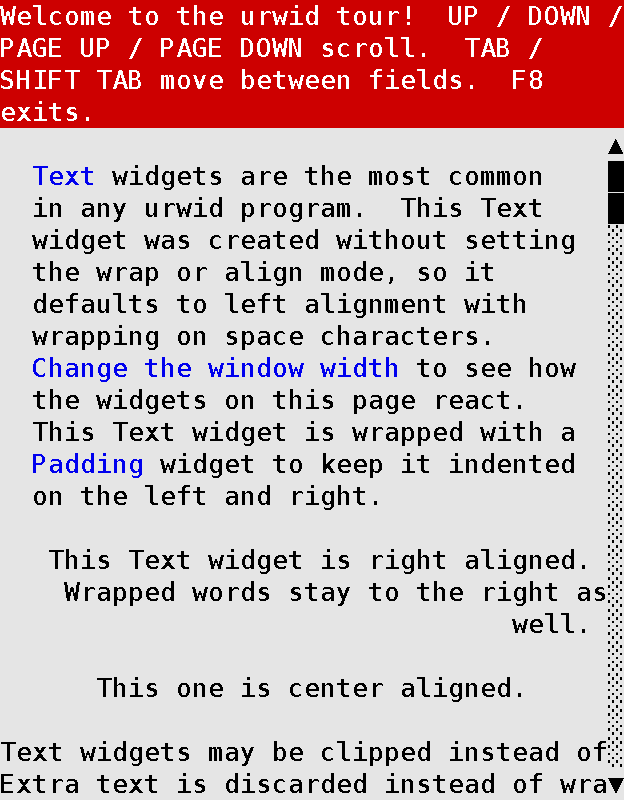
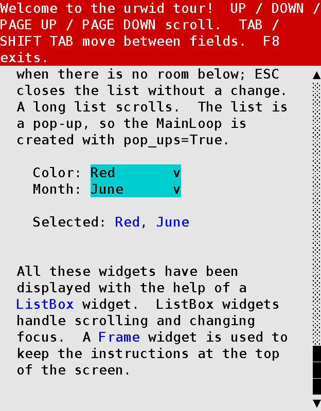
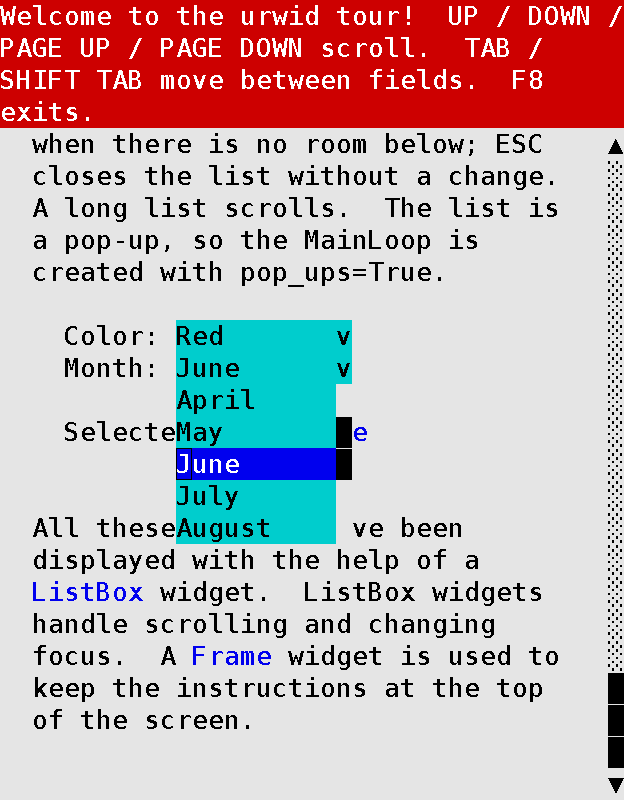

Show how many of the standard widgets may be arranged
on the screen, including a DropDown with its list open

graph.py
--------

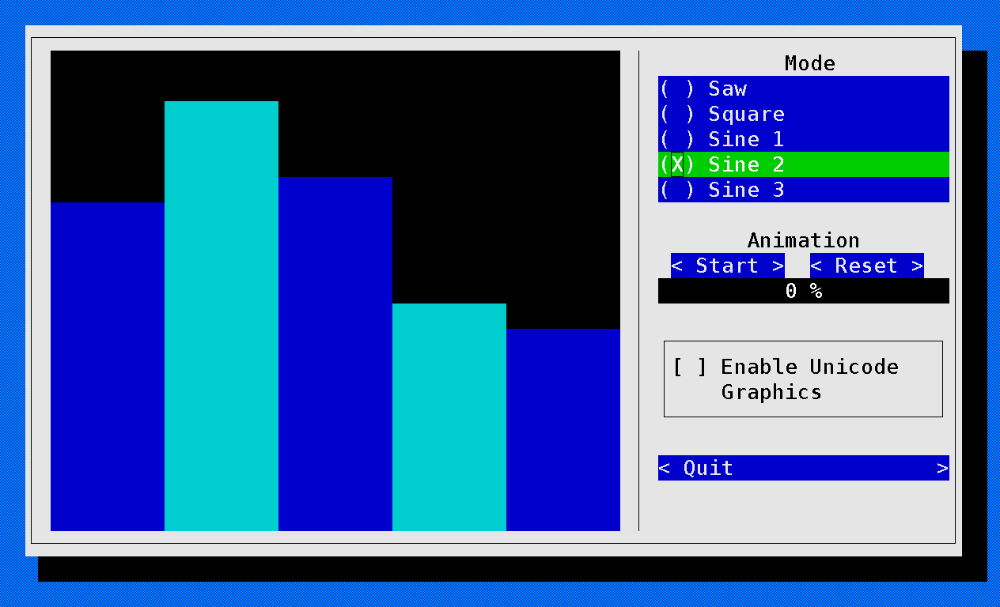

Demonstrate BarGraph widget and alarms used for animation

edit.py
-------

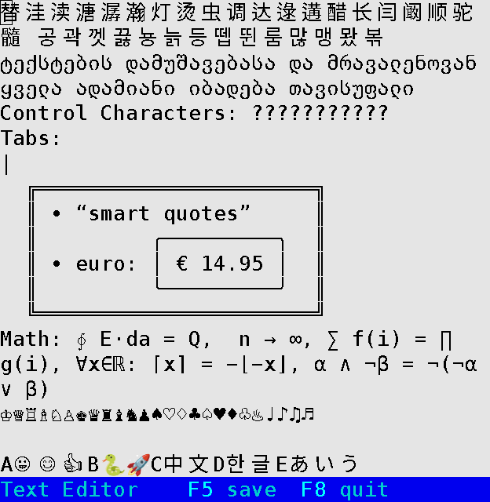
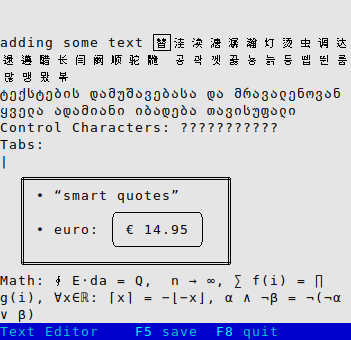

A simple text editor with lazy loading

browse.py
---------

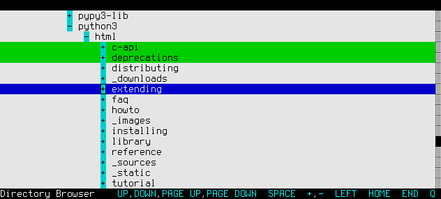

A lazy directory browser with file selection, tree-view, custom widgets
and list walker

subproc.py
----------

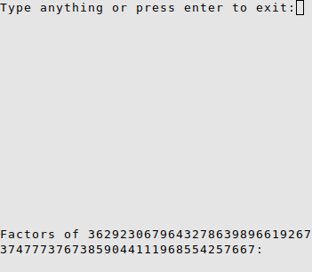
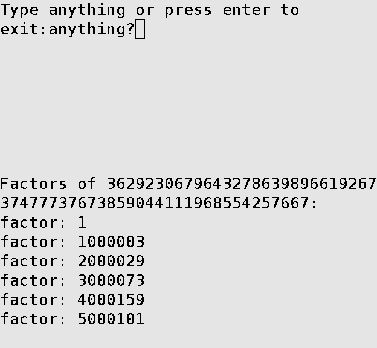

Monitor and display results from a subprocess

calc.py
-------

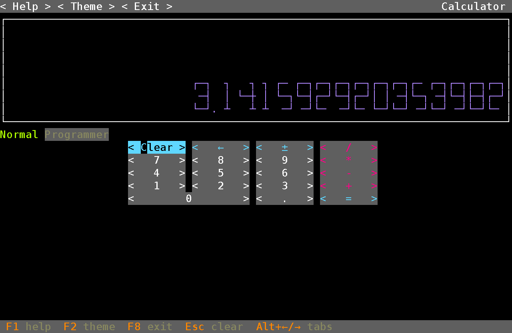
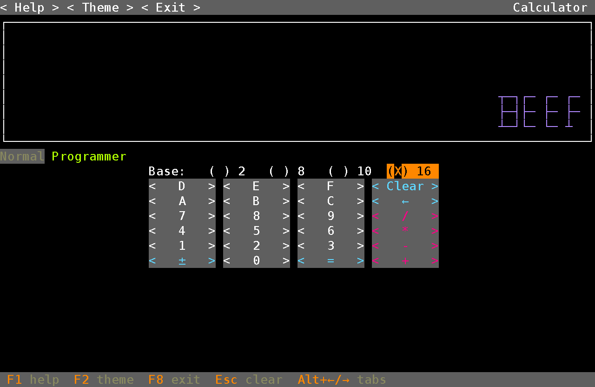
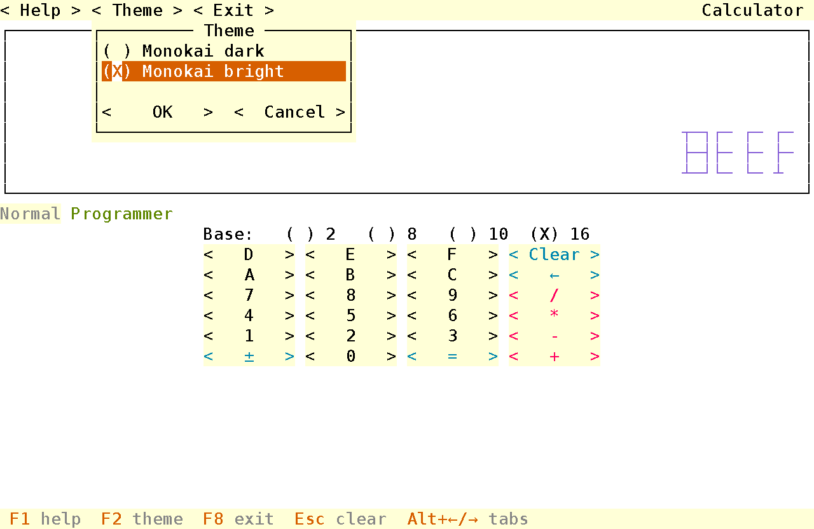
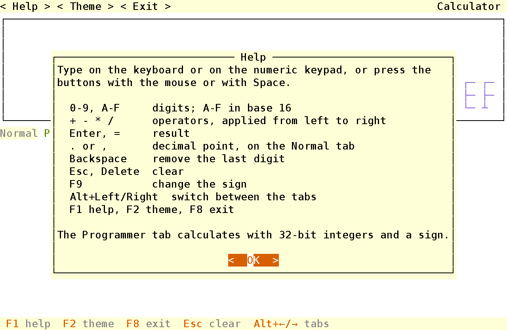

A calculator with a decimal and a programmer tab over one display of big
digits, which carries the number shown to the selected tab. It takes numeric
keypad input, and has a theme pop-up that previews the palette until OK or
Cancel, and a help dialog. The calculator logic is plain Python, kept apart
from the user interface in the same file

notifications.py
----------------

Messages of each severity in the footer of a window, each one dismissed after
five seconds, and a message that stays until it is dismissed

spinner.py
----------

A spinner for every frame preset, started, stopped, stepped and sped up together

external_editor.py
------------------

Hand the terminal to an external editor and show the text written in it

thread_worker.py
----------------

Run a slow computation on a worker thread and show its progress and result

palette_test.py
---------------

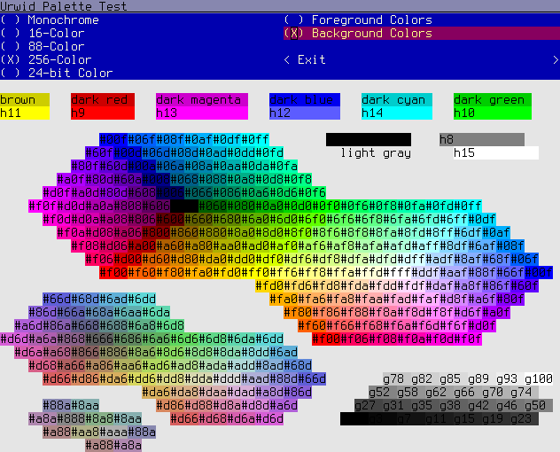

Show available colors in various screen modes

bigtext.py
----------

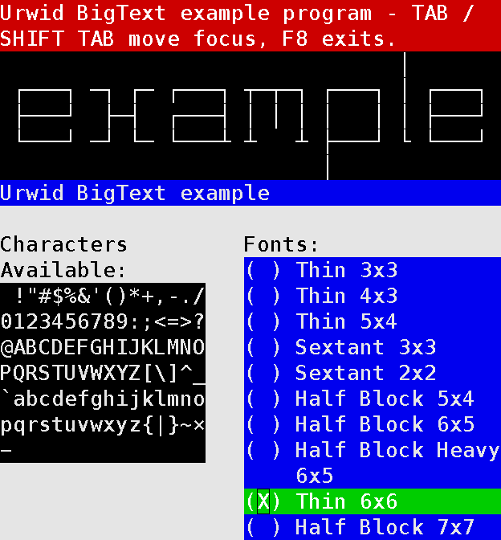
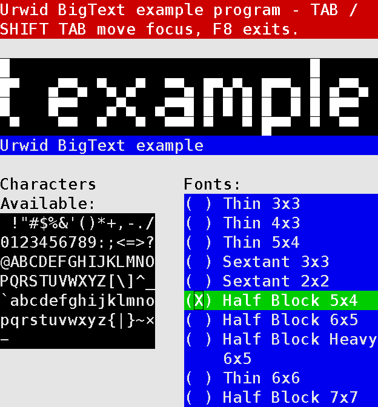

demonstrate the BigText widget
