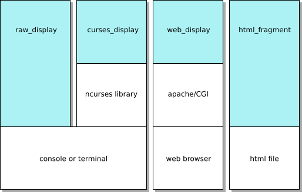

.. _display-modules:

*******************
  Display Modules
*******************

.. currentmodule:: urwid

Urwid's display modules provide a layer of abstraction for drawing to the
screen and reading user input. The display module you choose will depend on
how you plan to use Urwid.

Typically you will select a display module by passing it to your
:class:`MainLoop` constructor, eg:

::

    loop = MainLoop(widget, ..., screen=urwid.display.curses.Screen())

If you don't specify a display module, the default main loop will use
:class:`display.raw.Screen` by default

::

    # These are the same
    loop = MainLoop(widget, ...)
    loop = MainLoop(widget, ..., screen=urwid.display.raw.Screen())

Raw and Curses Display Modules
==============================

Urwid has two display modules for displaying to terminals or the console.

The :class:`display.raw.Screen` module is a pure-python display module with no
external dependencies. It sends and interprets terminal escape sequences
directly. This is the default display module used by
:class:`MainLoop`.

The :class:`display.curses.Screen` module uses the curses or ncurses library
provided by the operating system. The library does some optimization of screen
updates and uses termcap to adjust to the user's terminal.

The (n)curses library will disable colors if it detects a monochrome terminal,
so a separate set of attributes should be given for monochrome mode when
registering a palette with :class:`display.curses.Screen` High colors will not be
used by the :class:`display.curses.Screen` module. See :ref:`setting-a-palette`
below.

This table summarizes the differences between the two modules:

============================== =========== ==============
..                             raw display curses display
============================== =========== ==============
optimized C code               no          YES
compatible with any terminal   no          YES [1]_
UTF-8 support                  YES         YES [2]_
bright foreground without bold YES [3]_    no
88-/256-/24-bit color support  YES         no
mouse dragging support         YES         no
external event loop support    YES         no
OSC 8 hyperlinks               YES [4]_    no
window title                   YES [5]_    no
clipboard copy (OSC 52)        YES [6]_    no
============================== =========== ==============

.. [1] if the termcap entry exists and TERM environment variable is set
       correctly
.. [2] if python is linked against the wide version of ncurses
.. [3] when using xterm or gnome-terminal
.. [4] after ``set_terminal_properties(hyperlinks=True)``, see :ref:`hyperlinks`
.. [5] with :meth:`display.raw.Screen.set_title`; the previous title comes back
       when the screen stops, on terminals with a title stack and on the Windows console
.. [6] with :meth:`display.raw.Screen.copy_to_clipboard`, on terminals that support OSC 52

.. _screens-without-event-loop-support:

Screens Without Event Loop Support
==================================

The curses and web screens read their input themselves and cannot hand their
descriptors to an event loop, so :class:`MainLoop` drives them with a loop of its
own that waits in the screen's ``get_input()``.
Files watched with :meth:`MainLoop.watch_file`, and calls made with
:meth:`MainLoop.call_from_thread`, are handled when that wait ends.

The curses screen waits until a key arrives (a window resize counts as one) or the
next alarm is due, so a worker's update can wait until the user presses a key.
Pass ``poll_interval`` to cut the wait into polls, so they are handled within that
many seconds::

    loop = urwid.MainLoop(widget, screen=urwid.display.curses.Screen(), poll_interval=0.5)

Each poll wakes the process, which costs CPU time and power while the application is
idle, so set it only when something has to reach the screen without input, and
choose the longest interval the application can accept. The shortest is 0.1 seconds,
since the curses screen waits in tenths of a second.
An application with an alarm that fires regularly, such as a clock, gets the same
effect from that alarm.
On Windows the curses screen cannot stop waiting before a key arrives, so
``poll_interval`` has no effect there.

The web screen ends its wait every 0.5 seconds by itself, so it needs no
``poll_interval``, and a shorter one does not make it check sooner.

The raw display, the default, needs none of this: it waits on all its descriptors and
the watched files at once.

Other Display Modules
=====================

WebSocket Display Module ``display.websocket``
----------------------------------------------

The :mod:`urwid.display.websocket` module draws your application into a web
browser page over a WebSocket. It does not depend on an HTTP or WebSocket
library: a small adapter written for the server library you use connects one
:class:`display.websocket.Screen` to each WebSocket connection.

* The adapter serves the page from :func:`display.websocket.html_page` and the
  files in :data:`display.websocket.STATIC_FILES`.
* For each connection it creates a screen with a :class:`display.websocket.Transport`
  that sends text messages over that connection, and a :class:`MainLoop` on the
  event loop the server library runs on. It calls :meth:`MainLoop.start` instead of
  :meth:`MainLoop.run`, because the server library runs the event loop.
* It gives each main loop the shared event loop wrapped in a :class:`GuardedEventLoop`
  whose handler closes that session's screen. Without the wrapper, an exception in one
  session stops the event loop, and with it every session.
* It passes every message from the browser to :meth:`display.websocket.Screen.feed`
  and closes the connection when that raises
  :exc:`display.websocket.InvalidMessageError`.
* It calls :meth:`MainLoop.stop` when the connection closes.

Every session is a live connection: there are no files, pipes or session tokens on
the server. The screen accepts only the messages its page script sends: a known key
name, or a window size, in a message of limited length.
:exc:`ExitMainLoop` raised by an input handler ends only the session it was raised in.

The page has no inline script or style, so it works under a strict
``Content-Security-Policy``. The screen itself does no access control: the adapter
checks the ``Origin`` of each WebSocket handshake, limits the message size and the
number of sessions, and authenticates users, also on a loopback address, which every
user of the host can reach.

The websocket_tornado.py_ example is such an adapter for Tornado, with these checks
in place, a limit on failed logins, and a :class:`GuardedEventLoop` per session.

.. warning::
    The example shows how to connect the screen to a server library; it is not a
    production server. Its TLS support only loads a given certificate and key, and it
    was not tested against real clients. Whoever builds a production service is
    responsible for its TLS: the certificates and their renewal, the protocol versions
    and ciphers, and usually a reverse proxy or load balancer that terminates TLS. The
    same holds for authentication beyond the single shared token of the example.

.. _websocket_tornado.py: https://github.com/urwid/urwid/blob/master/examples/websocket_tornado.py

CGI Web Display Module ``display.web``
--------------------------------------

The :mod:`urwid.display.web` module lets you run your application as a CGI
script under Apache instead of running it in a terminal.

This module is a proof of concept. There are security and responsiveness issues
that need to be resolved before this module is recommended for production use.

The tour.py_ example program demonstrates use of this module.

.. _tour.py: https://github.com/urwid/urwid/blob/master/examples/tour.py

Screenshot Display Module ``html_fragment``
-------------------------------------------

Screenshots of Urwid interfaces can be rendered in plain HTML. The
:class:`display.html_fragment.HtmlGenerator` display module lets you do this by simulating user input
and capturing the screen as fragments of HTML each time
:meth:`display.html_fragment.HtmlGenerator.draw_screen` is
called.

These fragments may be included in HTML documents. They will be rendered
properly by any browser that uses a monospaced font for text that appears in
``<pre>`` tags. HTML screenshots have text that is searchable and selectable in
a web browser, and they will shrink and grow when a user changes their
browser's text size.

The `example screenshots`_ are generated with this display module.

.. _`example screenshots`: http://urwid.org/examples/index.html

LCD Display Module ``display.lcd``
----------------------------------

.. deprecated:: 5.1.0
    The LCD display module will be removed in version 6.0, with no replacement.

Almost any device that displays characters in a grid can be used as a
screen.  The :mod:`display.lcd` module has some base classes for simple
LCD character display devices and a complete implementation of a
:class:`display.lcd.CF635Screen` for Crystal Fontz 635 USB displays with
6 buttons.

The lcd_cf635.py_ example program demonstrates use of this module.

.. _lcd_cf635.py: https://github.com/urwid/urwid/blob/master/examples/lcd_cf635.py

.. seealso:: `Urwid on a Crystalfontz 635 LCD <http://excess.org/article/2010/03/urwid-crystalfontz-635-lcd/>`_

.. _setting-a-palette:

Setting a Palette
=================

The :class:`MainLoop` constructor takes a *palette* parameter that it passes
to the :meth:`register_palette() <BaseScreen.register_palette>` method of your display module.

A palette is a list of :ref:`display attribute <display-attributes>` names and foreground
and background settings. Display modules may be run in monochrome, normal or
high color modes and you can set different foregrounds and backgrounds for each
mode as part of your palette. eg:

::

    loop = MainLoop(widget, palette=[
        ('headings', 'white,underline', 'black', 'bold,underline'), # bold text in monochrome mode
        ('body_text', 'dark cyan', 'light gray'),
        ('buttons', 'yellow', 'dark green', 'standout'),
        ('section_text', 'body_text'), # alias to body_text
        ])

The :ref:`display-attributes` section of this manual describes all the options
available.
